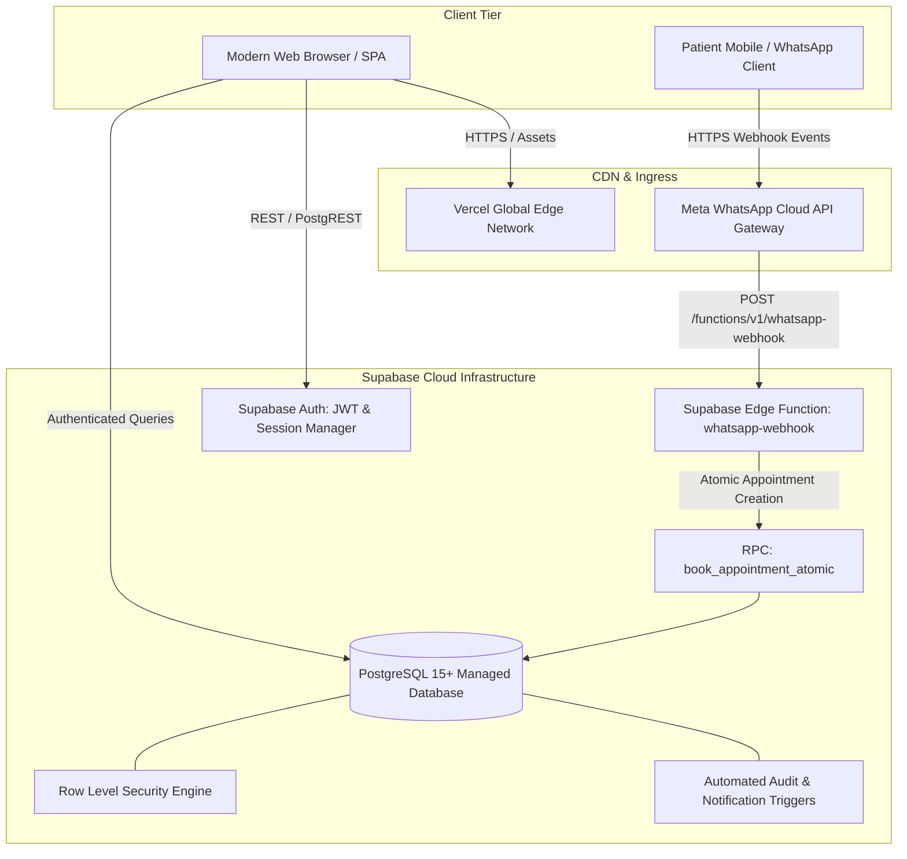

# ClinicFlow — Multi-Tenant Healthcare SaaS & WhatsApp Patient Interface

[](https://chennai.vit.ac.in)
[](https://chennai.vit.ac.in)
[](#technology-stack)
[](#security--row-level-security-rls)
[](#whatsapp-cloud-api-architecture)
[](#automated-verification-test-results)
[](#cloud-deployment)

> **Academic Year:** 2026–2027  
> **Course Code:** BCSE408L — Cloud Computing  
> **Institution:** Vellore Institute of Technology (VIT), Chennai  
> **Author:** T. R. Jayasankar (Reg. No: 23BLC1190)  
> **Project Title:** ClinicFlow — Digital Healthcare Management & Multi-Tenant Clinical SaaS with WhatsApp Cloud Interface  

---

## 🌐 Live Application & Access Details

- **Public Live Application URL:** [https://clinicflow-saas.vercel.app](https://clinicflow-saas.vercel.app) *(or active temporary preview deployment)*
- **GitHub Repository URL:** `<Provided upon evaluation submission>`
- **Supabase Cloud Backend:** Managed PostgreSQL 15+, Supabase Auth, Storage & Edge Functions

### 🔑 Active Testing Login Credentials

The application provides instant 1-click demo logins or standard email/password authentication for all 4 enterprise roles:

| Role | Email / Login | Password | Scope & Primary Capabilities |
| :--- | :--- | :--- | :--- |
| **Supercoordinator** | `super@clinicflow.demo` | `Super@123` | Platform-wide owner; monitors all hospitals, WhatsApp sessions, telemetry, and platform audit logs. |
| **Hospital Admin** | `admin@clinicflow.demo` | `Admin@123` | Hospital manager (Apollo Hospital); manages staff (doctors/receptionists), hospital settings, and WhatsApp credentials. |
| **Doctor** | `doctor@clinicflow.demo` | `Doctor@123` | Clinical staff; conducts consultation rooms, diagnoses, electronic prescriptions (Rx), and appointments. |
| **Receptionist** | `receptionist@clinicflow.demo` | `Reception@123` | Front-desk operations; patient intake, token queue management, and offline appointment scheduling. |

> **Note on Patients:** In ClinicFlow, patients do not undergo web account creation or remember passwords. Patients interact directly via their primary mobile messenger using the **Meta WhatsApp Cloud API interface** (or the built-in **Interactive In-App WhatsApp Simulator**).

---

## 1. Executive Summary & Problem Statement

Outpatient clinical centers face three major operational bottlenecks:
1. **Inefficient Scheduling & Double-Booking Conflicts:** High-frequency phone bookings often result in schedule collisions, doctor burnout, and prolonged waiting room delays.
2. **Fragmented Multi-Clinic Administration:** Healthcare networks operating multiple branch hospitals struggle to enforce strict cross-hospital data isolation while maintaining centralized platform telemetry.
3. **High Patient Friction:** Requiring patients to download native mobile apps or remember web portal passwords leads to high abandonment rates and missed follow-ups.

**ClinicFlow** solves these challenges by delivering an enterprise-grade, multi-tenant Cloud SaaS platform that:
- Implements a hierarchical multi-tenant architecture (**Supercoordinator $\rightarrow$ Hospital $\rightarrow$ Hospital Admin $\rightarrow$ Doctors / Receptionists**).
- Eliminates patient portal fatigue by providing a conversational booking interface powered by the **Meta WhatsApp Cloud API**.
- Enforces cryptographic database-level data isolation via **PostgreSQL Row Level Security (RLS)** and atomic concurrency protection via **PostgreSQL Transactional RPCs (`book_appointment_atomic`)**.

---

## 2. Multi-Tenant Healthcare Hierarchy

```
                          ClinicFlow Platform
                                   │
                         [ Supercoordinator ]
                     (Platform operator, logs,
                      cross-tenant monitoring)
                                   │
         ┌─────────────────────────┴─────────────────────────┐
         ▼                                                   ▼
    Hospital A                                          Hospital B
  (whatsapp_id_A)                                     (whatsapp_id_B)
         │                                                   │
   [Hospital Admin]                                    [Hospital Admin]
         ├── [Doctor 1]                                      ├── [Doctor]
         ├── [Doctor 2]                                      └── [Receptionist]
         └── [Receptionist]                                          │
         │                                                           ▼
         ▼                                                       Patients
      Patients                                               (Zero Web Auth)
  (Zero Web Auth)                                                    │
         │                                                           ▼
         ▼                                                    WhatsApp Patient
  WhatsApp Patient                                               Interface
     Interface
```

### Role Separation & Boundaries
1. **Supercoordinator (Platform Operator):** Oversees the health of the entire multi-tenant network, registers new hospitals, reviews platform audit logs, and monitors real-time WhatsApp session throughput. Zero modification of patient clinical consultation records.
2. **Hospital Admin:** Dedicated administrator for a specific hospital (e.g., Apollo Multi-Specialty). Manages clinic rosters, creates doctor/receptionist accounts, and configures hospital-specific WhatsApp Phone IDs. Cannot access another hospital's records.
3. **Doctor:** Scoped strictly to their affiliated hospital. Manages appointment queues, initiates clinical consultations, issues multi-drug digital prescriptions, and reviews longitudinal medical records.
4. **Receptionist:** Manages patient walk-in intake, token queue dispatching, and manual appointment booking for the affiliated hospital.
5. **Patient (Conversational Consumer):** Decoupled from web authentication. Identified by their verified E.164 WhatsApp phone number (`whatsapp_number`) linked directly to a hospital record.

---

## 3. System & Cloud Architecture



---

## 4. Key Architectural Capabilities

### A. Zero-Trust PostgreSQL Row Level Security (RLS)
Security is strictly enforced in PostgreSQL engine transactions:
- Multi-tenant tenant boundary checks query `auth.jwt() -> app_metadata -> hospital_id` via custom SQL helper functions (`current_user_hospital_id()`, `is_supercoordinator()`).
- All tenant entities (`hospitals`, `profiles`, `doctors`, `receptionists`, `patients`, `appointments`, `encounters`, `prescriptions`, `reports`, `audit_logs`, `whatsapp_sessions`, `whatsapp_messages`) carry strict RLS policies.
- Direct client manipulation or ID injection attacks across hospitals are blocked at the database layer.

### B. Concurrency-Safe Atomic Booking (`book_appointment_atomic`)
To eliminate double-booking race conditions during simultaneous patient booking attempts:
- A PostgreSQL stored procedure executes inside an isolated transaction.
- An exclusive row/schedule lock (`SELECT ... FOR UPDATE`) inspects the doctor's active schedule for temporal overlap (`(start_time, end_time) OVERLAPS (p_start_time, p_end_time)`).
- If an overlap exists, an explicit PostgreSQL exception is raised (`Double-booking conflict`).
- Sequential queue token numbers (`token_number`) are computed atomically per doctor per day.

### C. Meta WhatsApp Cloud API State Machine
The serverless Edge Function (`supabase/functions/whatsapp-webhook/index.ts`) handles incoming Meta webhooks through a deterministic state machine:
- **Idempotency Guarantee:** Deduplicates incoming requests using the unique Meta `whatsapp_message_id`.
- **State Progression:** `IDLE` $\rightarrow$ `MAIN_MENU` $\rightarrow$ `SELECTING_DOCTOR` $\rightarrow$ `SELECTING_DATE` $\rightarrow$ `SELECTING_SLOT` $\rightarrow$ `CONFIRMING_APPOINTMENT` $\rightarrow$ `COMPLETED`.
- **Zero-Friction Patient Onboarding:** Automatically collects patient full name on first interaction and binds their WhatsApp number to the receiving hospital.

---

## 5. Technology Stack

| Layer | Technologies | Rationale |
| :--- | :--- | :--- |
| **Frontend Framework** | **React 18 + Vite** | Blazing-fast Single Page Application (SPA) with optimized bundle splitting and hot reload. |
| **Language** | **TypeScript 5.7** | Strict compile-time type safety preventing runtime type errors across complex clinical models. |
| **Styling & UI** | **Tailwind CSS + Lucide Icons** | High-density hospital design system with responsive layouts and print styling for prescriptions. |
| **Database & Auth** | **Supabase (PostgreSQL 15+)** | ACID-compliant relational DBaaS with Row Level Security, JSONB, and custom RPC procedures. |
| **Edge Compute** | **Deno / Supabase Edge Functions** | Ultra-low latency serverless webhook processing for Meta WhatsApp events. |
| **Deployment** | **Vercel / Netlify** | Global Edge CDN with automated Single-Page Application URL rewrite routing. |

---

## 6. Automated Verification Test Results

ClinicFlow includes an automated verification test suite ([`src/services/whatsappSimulation.ts`](src/services/whatsappSimulation.ts)) covering 9 critical multi-tenant and concurrency scenarios:

```bash
npx tsx -e "import { runAllClinicFlowTests } from './src/services/whatsappSimulation'; runAllClinicFlowTests().then(r => console.log(JSON.stringify(r, null, 2)));"
```

```json
{
  "total": 9,
  "passed": 9,
  "failed": 0
}
```

| # | Test Scenario | Category | Result | Verified Behavior |
| :---: | :--- | :--- | :---: | :--- |
| **1** | **Doctor Filtering & Isolation** | Hospital Isolation | **PASSED** | Hospital A lists 3 doctors and Hospital B lists 1 doctor with zero cross-tenant leakage. |
| **2** | **Genuine Slot Filtering** | Appointment Scheduling | **PASSED** | Real-time exclusion of existing bookings ensures only available slots are offered. |
| **3** | **Concurrent Booking Race Condition** | Anti-Double-Booking | **PASSED** | Atomic RPC lock allows exactly 1 booking; concurrent duplicate request is cleanly rejected. |
| **4** | **Webhook Idempotency Protection** | Webhook Security | **PASSED** | Meta duplicate webhook delivery (`wamid...`) is identified and deduplicated. |
| **5** | **Patient Data Isolation** | Zero-Trust Security | **PASSED** | Patient appointment history is completely isolated between patients. |
| **6** | **Hospital Multi-Tenant Boundary** | Tenant Isolation | **PASSED** | Cross-hospital data access is blocked by PostgreSQL database policies. |
| **7** | **Cross-Hospital Doctor ID Injection** | Input Validation | **PASSED** | Foreign doctor IDs passed into an unauthorized hospital session are rejected. |
| **8** | **Meta Webhook Verification Security** | Webhook Security | **PASSED** | Invalid `hub.verify_token` requests are rejected with HTTP 403; valid tokens echo challenge. |
| **9** | **System Resilience** | High Availability | **PASSED** | Clinical workflows operate uninterrupted even if WhatsApp API credentials are unconfigured. |

---

## 7. Local Development Quickstart

### Prerequisites
- Node.js 18+ (tested on Node.js 24)
- npm 9+

### Installation & Run
```bash
# Clone the repository
git clone <repository-url>
cd clinicflow_saas

# Install dependencies
npm install

# Start local Vite development server
npm run dev
```

Visit `http://localhost:5173` in your browser. The application runs immediately in high-fidelity mock mode with pre-seeded multi-tenant data.

### Testing WhatsApp Simulator
1. Log in as **Supercoordinator** (`super@clinicflow.demo`).
2. Navigate to **WhatsApp Monitor** (`/supercoordinator/whatsapp`).
3. Interact with the live WhatsApp smartphone simulator on the right panel to test patient booking end-to-end.

---

## 8. Cloud Deployment Guide

### Deploying to Vercel
1. Push your code to a GitHub repository.
2. Import the project into [Vercel](https://vercel.com).
3. Set the Framework Preset to **Vite**.
4. Configure environment variables (`VITE_SUPABASE_URL`, `VITE_SUPABASE_ANON_KEY`, `VITE_APP_URL`).
5. Vercel automatically honors `vercel.json` for SPA URL rewrites:
   ```json
   {
     "rewrites": [{ "source": "/(.*)", "destination": "/index.html" }]
   }
   ```
6. Click **Deploy**.

### Deploying Supabase Migrations & Edge Function
```bash
# Push database migrations (05, 06, 07)
supabase db push

# Deploy WhatsApp webhook function
supabase functions deploy whatsapp-webhook --no-verify-jwt

# Set Edge Function secrets
supabase secrets set META_WHATSAPP_ACCESS_TOKEN="<token>"
supabase secrets set META_WHATSAPP_VERIFY_TOKEN="clinicflow_verify_token_2026"
supabase secrets set META_WHATSAPP_PHONE_NUMBER_ID="<phone-id>"
```

---

## 9. Academic Declaration
This project is submitted in partial fulfillment of the requirements for **BCSE408L — Cloud Computing**, Academic Year 2026–2027, VIT Chennai. All architectural diagrams, source code, database migrations, and testing routines were authored by the project team.
